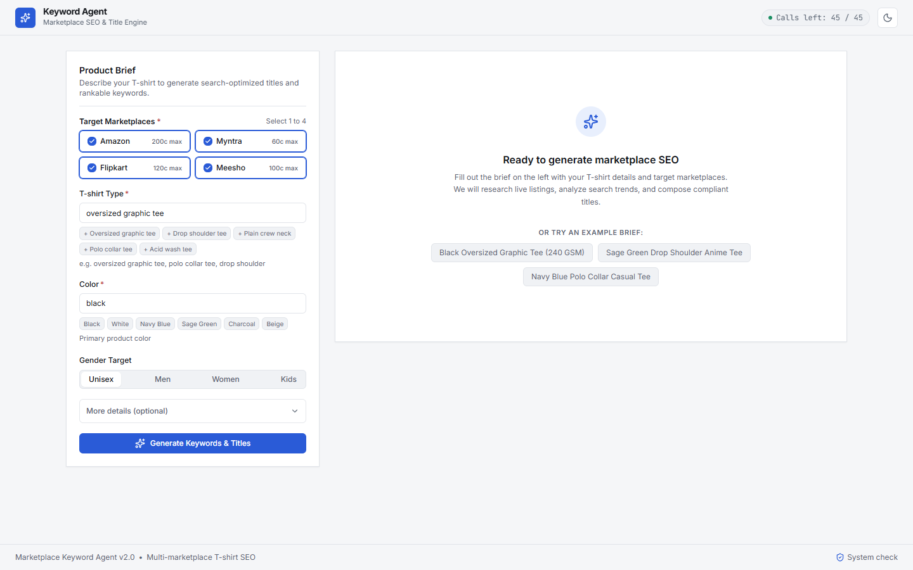
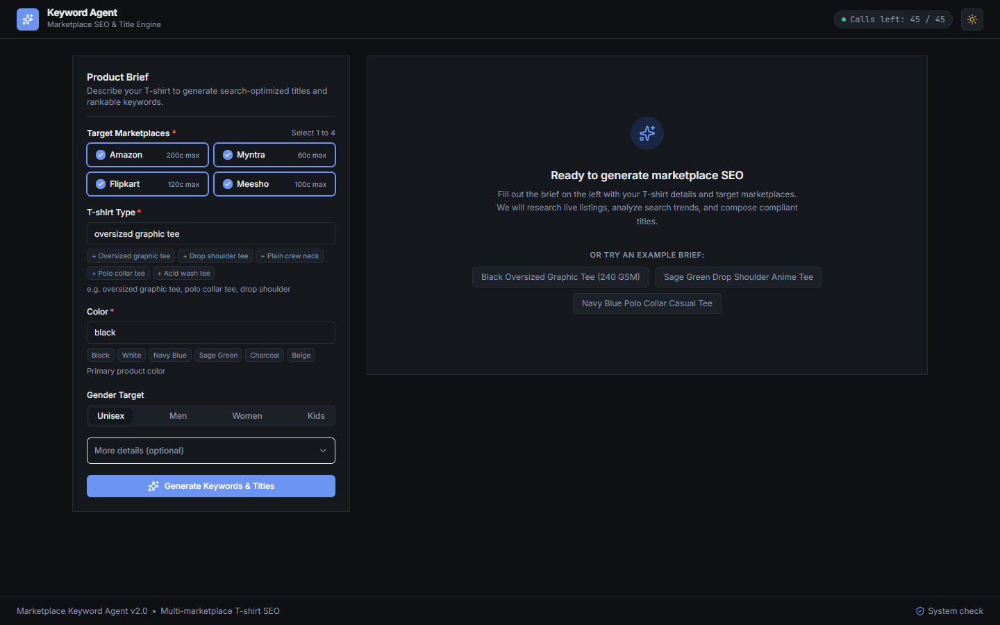
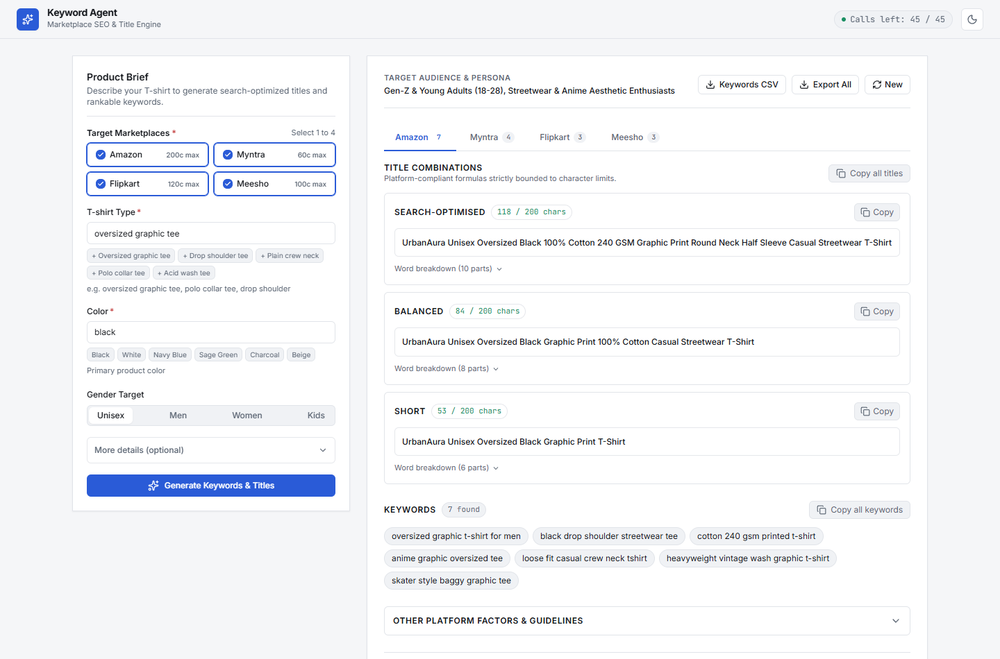
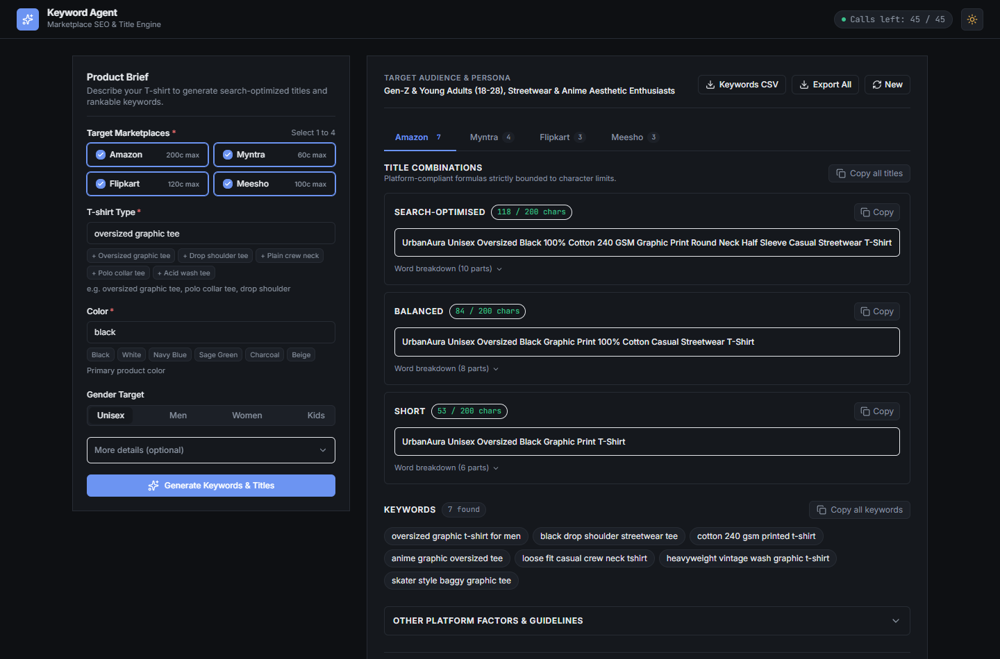
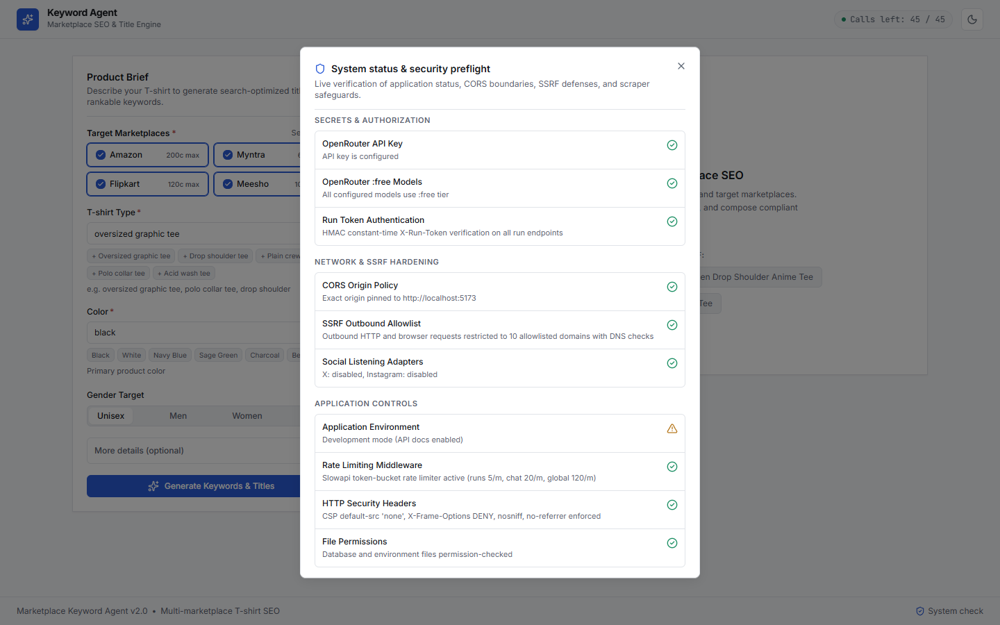

# Marketplace Keyword Agent

A clean, professional multi-agent e-commerce SEO & Title Engine built for Indian fashion sellers. Features a single-page application (React 18 + Vite + TypeScript + Tailwind 3.4), a 4-agent backend pipeline (FastAPI + OpenRouter `:free`), pure Python mathematical scoring, and a **deterministic code-composed Title Engine** driven by verified marketplace seller documentation (`Amazon`, `Myntra`, `Flipkart`, `Meesho`).

---

## 1. Visual Walkthrough & Screenshots

| View | Mode | Screenshot |
|---|---|---|
| **Single-Page Application** | Light Mode |  |
| **Single-Page Application** | Dark Mode |  |
| **Generated Titles & Keywords** | Light Mode |  |
| **Generated Titles & Keywords** | Dark Mode |  |
| **System Check Preflight Modal** | Light Mode |  |

---

## 2. Architecture & Design Principles

### Single-Page Layout
- **Left Column (400px sticky)**: Product brief form. Select 1 to 4 marketplaces (`Amazon`, `Myntra`, `Flipkart`, `Meesho`), enter T-shirt type and color with one-click chips, choose gender target, expand optional details (Fit, Fabric, Neck, Sleeve, Pattern, Occasion, Pack, Size, Price band, Brand, Extra details), and trigger generation.
- **Right Column (Flexible)**: Transitions cleanly from an empty state with clickable sample briefs $\rightarrow$ a 4-step progress list $\rightarrow$ full results:
  - **Target Audience Summary**: Single muted line at the top.
  - **Platform Tabs**: Radix-powered tabs switching between selected marketplaces.
  - **Title Combinations**: Exactly 3 TitleCards (`Search-optimised`, `Balanced`, `Short`) with live length counters (`118 / 200 chars`), color-coded thresholds, composed title text, copy button, and expandable part breakdown.
  - **Keywords**: Pure chips only (best-first, count badge, click-to-copy, and copy-all button).
  - **Other Details**: Collapsible accordion covering key attributes to fill, price band, negative keywords (never target), trend hashtags, competition notes, and seasonality.
  - **Refinement Chat**: Single-line inline chat at the bottom allowing real-time AI adjustments.

---

## 3. Deterministic Title Engine

Titles are **never output as raw LLM strings**. Instead, the backend Title Engine validates and composes each title using strict platform rules defined in `backend/app/titles/rules.yaml`:

| Platform | Formula Order | Recommended Length | Hard Limit | Cited Seller Guide |
|---|---|---|---|---|
| **Amazon** | `Brand` + `Gender` + `Fit` + `Color` + `Fabric` + `Pattern` + `Neck` + `Sleeve` + `Occasion` + `T-shirt Type` | 80 - 150 chars | 200 chars | Amazon.in Style Guide for Clothing |
| **Myntra** | `Brand` + `Gender` + `Color` + `Fit` + `Pattern` + `Occasion` + `T-shirt Type` | 40 - 55 chars | 60 chars | Myntra Partner Portal Product Naming |
| **Flipkart** | `Brand` + `Pattern` + `Gender` + `Fit` + `Color` + `Neck` + `T-shirt Type` | 50 - 80 chars | 120 chars | Flipkart Seller Hub Title Guidelines |
| **Meesho** | `Brand` + `Key Feature` + `Gender` + `Color` + `Fit` + `Pattern` + `Neck` + `Sleeve` + `Occasion` + `T-shirt Type` | 40 - 70 chars | 100 chars | Meesho Supplier Panel Product Listing |

### Title Validation Pipeline (`validator.py` & `composer.py`)
1. **Vocabulary Whitelist**: Only words from the user's brief, high-confidence scored keywords, or approved clothing taxonomy are permitted.
2. **Unsupported Claim Dropping**: Claims not present in the brief (e.g. `cotton`, `100%`, `240 GSM`) are dropped with warnings rather than invented.
3. **Brand Integrity**: Unprovided brand names are omitted cleanly without placeholder tokens.
4. **Length Enforcement & Pruning**: If a title exceeds platform limits, non-essential attributes are pruned in deterministic priority order (`key_feature` $\rightarrow$ `occasion` $\rightarrow$ `pack` $\rightarrow$ `sleeve` $\rightarrow$ `neck` $\rightarrow$ `fabric` $\rightarrow$ `pattern` $\rightarrow$ `fit` $\rightarrow$ `gender`), preserving `tshirt_type` and `color`.

---

## 4. The 4-Agent Pipeline

The system coordinates **strictly 4 agents** via `asyncio` workflows and Server-Sent Events (SSE):

1. **Agent 1: Planner (LLM)**: Analyzes the product brief, infers buyer personas, and generates targeted search queries.
2. **Agent 2: Marketplace Scraper (0 LLM)**: Concurrently searches Amazon.in, Myntra, Flipkart, and Meesho via resilient browser automation, embedded JSON extraction, and autosuggest APIs.
3. **Agent 3: Social Scraper (<= 1 LLM)**: Searches organic shopper demand signals across Reddit, Google Autocomplete, and Pinterest.
4. **Deterministic Multi-Factor Scoring (0 LLM)**: Mathematical scoring engine evaluates candidate n-grams across 5 weighted factors.
5. **Agent 4: AI Analyst (LLM / Fallback)**: Proposes title parts and ranks top keywords. Composed via deterministic Title Engine.

---

## 5. Security & Verification Posture

- **OpenRouter Free Tier Only**: Only `:free` models used. Daily token-bucket rate limiting ($16 \text{ RPM}$, $50 \text{ calls/day}$).
- **SSRF Defense**: Outbound requests strictly validated against allowlisted domains (`amazon.in`, `myntra.com`, `flipkart.com`, `meesho.com`, `reddit.com`, `openrouter.ai`).
- **CSV Injection Defense**: Cells starting with `=`, `+`, `-`, `@`, `\t`, `\r` are sanitized with quote prefixes.
- **Constant-Time Tokens**: SSE streams, run queries, and chat endpoints require HMAC constant-time verified `X-Run-Token` headers.
- **Automated Security Scan**: Pre-release scan verifies zero High/Critical vulnerabilities via `bandit`, `pip-audit`, `ruff -S`, `npm audit`, secret scanning, and permission checks.

---

## 6. Getting Started

### Prerequisites
- Python 3.11+
- Node.js 18+
- OpenRouter API Key (stored exclusively in `backend/.env`)

### Installation & Run

```bash
# 1. Setup backend and frontend dependencies
make setup

# 2. Run test suites
make test

# 3. Start development servers
make backend    # Runs on http://127.0.0.1:8000
make frontend   # Runs on http://localhost:5173
```

---

## 7. Verification Commands

```bash
# Run backend pytest suite (64 unit and integration tests)
backend/.venv/Scripts/pytest backend/tests/ -v

# Run frontend typecheck and tests
cd frontend && npm run typecheck
cd frontend && npm test -- --run
cd frontend && npm run build

# Run security scan
backend/.venv/Scripts/python scripts/security_scan.py
```
